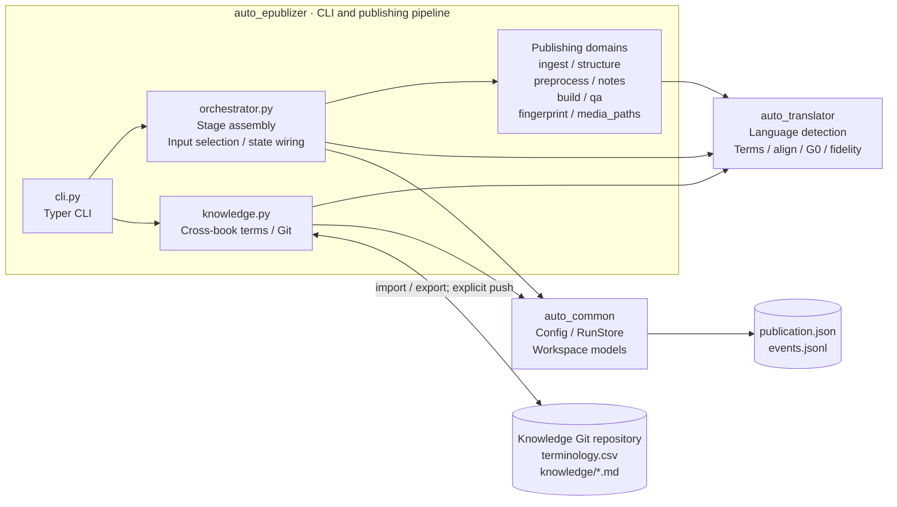
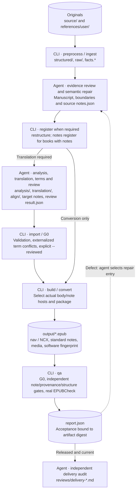

<!-- i18n: source=architecture.zh.md sha256=e1df12a35f14d412760580c3fd8a8c339d9750e13cff1015d375f633c3b80f4b -->
> **English** | [中文](architecture.zh.md)

# Current auto-epublizer architecture

This page describes **the current source implementation**, not design constraints or disconnected modules presented as running capabilities. The project is a file-workspace-driven Python CLI, not a persistent translation service; its only LLM is the external agent operating the CLI. Update this page when package boundaries, commands, persistence or acceptance paths change.

## 1. Components and dependencies

Solid edges show principal production calls or state persistence, not an exhaustive per-file import graph. Ordinary content-file I/O edges are omitted. Utility commands such as doctor, metadata editing and work-root scaffolding are not expanded.

### Package boundaries and implementation reality

- **`auto_common` is the foundation**: configuration, workspace models, source identity and atomic state I/O. It does not import either upper package.
- **`auto_translator` contains deterministic domain tools**: no translation worker, LLM provider or semantic reviewer. Allowing a translator-to-common dependency does not mean that an import currently exists: epublizer presently connects to both packages, so translator → common must not be drawn as an active call edge.
- **`auto_epublizer` is the publishing application**: ingest, registration, building, acceptance and CLI. There is no separate `services/` package. Stage assembly, per-unit source/target selection, per-note host planning and some registration logic remain in `orchestrator.py`; the “thin façade” goal does not mean these responsibilities have already been extracted.
- **A pure function is not necessarily a connected production capability**: the style-document helper in `analysis/service.py`, genre profiles and `review/convergence.py` do not form an automatic analysis/review loop. There is currently no `analyze`, automatic translation or automatic G1–G3 execution command.
- **No active SQLite terminology backend**: `Glossary` is an in-memory index; workspace terminology is authoritative in CSV. Historical references to `glossary.db` must not be drawn as a running database.

## 2. Agent/CLI collaboration and data flow

This is a typical execution path, not a CLI-run semantic pipeline. The agent writes understanding, translation and review results; the CLI performs deterministic processing, contract checks and registration. Books with notes require source verification, separation and registration before translation.

- `preprocess` emits facts and suspicious signals, not semantic repair decisions. Editing source-body text does not always require `restructure`; changes to the unit set, boundaries or descriptors do. The current implementation compares unit descriptor fields, not body digests, when deciding state rollback.
- `structured/notes.json` holds stable note/ref identities, complete source-note content and original-location evidence; body markers `[^ref-…]` retain reference locations. `notes register` checks candidate dispositions, graph contracts and two-way marker reconciliation; the CLI does not author semantic content.
- `translation/notes.json` binds the source-note digest and preserves note_id. The same actual-input/host plan constrains build rendering and QA, rather than guessing from a target-note file's presence. Unused target notes are not treated as product content.
- `convert` uses source text; `build` prefers target text with per-unit source fallback when missing. Source fallback does not prove that a complete translation exists. Alignment is a review/fidelity baseline, not a product-layout switch.
- `import --reviewed` explicitly registers the agent's review acceptance; it does not run semantic review. QA reads agent review statistics rather than judging translation accuracy. The agent selects the appropriate repair entry; there is no automatic semantic-fixing loop.

## 3. Authority, derived artifacts and state

| Data | Ownership / purpose | Must not be mistaken for |
|---|---|---|
| `source/`, `references/user/` | Immutable originals; source SHA-256 recorded at initialization | Editable working copies |
| `publication.json` | Metadata, units, state and note digest atomically registered by the CLI through RunStore | An agent-editable checklist |
| `structured/*.md`, `structured/raw/`, source `notes.json` | Source manuscript, rebuildable parsing evidence and agent-verified source-note graph | Entirely immutable data or fully automatic CLI repairs |
| `raw/inserts/<id>.json` | Per-insert authority; agent supplies descriptions/LaTeX | An `index.jsonl` summary replacing individual records |
| `preprocessing/facts.*` / other preprocessing files | CLI refreshes facts; agent maintains plan/global/repairs, etc. | Fact collection completing semantic understanding |
| `analysis/glossary.csv`, `analysis/glossary_conflicts.jsonl` | Workspace terminology authority and unresolved-conflict ledger | SQLite; changing CSV necessarily clearing every conflict |
| `translation/`, `align/*.jsonl`, target `notes.json` | Agent semantic artifacts; import validates/registers them; align may receive deterministic erratum annotations | File presence proving registered state |
| `reviews/review-*/result.json`, delivery records | Agent review/delivery evidence; CLI reads statistics or warns about missing records | Automatic CLI G1–G3 review or reader testing |
| `report.json`, `output/*.epub` | QA evidence and product bound through actual artifact digests | Historical released=true remaining valid forever |
| Knowledge repository `terminology.csv`, `conflicts.jsonl`, `knowledge/*.md` | Cross-book terms, historical conflicts and agent notes, persisted in Git | Automatic knowledge reasoning or bidirectional synchronization |

RunStore manages state through same-directory temporary files, `fsync`, `os.replace` and locks; `events.jsonl` is append-only. `.progress.json` is a reserved path, not the current batch-checkpoint implementation.

The model declares `pending / split / analyzed / translated / aligned / reviewed / built`. The principal current transitions are initialization/parsing → split, import → translated/aligned, `--reviewed` → reviewed, and build/convert → built. `analyzed` does not imply an automatic analysis command. `built` means packaging completed, not QA release or completion of the agent delivery audit.

## 4. External tools and release boundaries

| Boundary | Current behavior |
|---|---|
| Local ingest | Local TXT/Markdown parsing; Pandoc for HTML/DOCX; EPUB spine reading with Pandoc; calibre converts Kindle inputs to temporary EPUB |
| PDF | Auto mode selects MinerU for scanned input with a key, otherwise PyMuPDF. Optional local RapidOCR runs on pages without text. Forced backend configuration is honored; MinerU failure does not automatically fall back locally |
| Optional remote parsing | MinerU is an external HTTP parsing service; its key comes only from the environment. Its internal implementation is not drawn as an internal project LLM. Tesseract/ocrmypdf capability hints do not imply automatic reader integration |
| External validation | EPUBCheck runs in a local Java process and needs the complete JAR with adjacent lib. No GUI is required. Success requires actual `ran=true && returncode=0 && errors=0` |
| Git | Knowledge import may commit locally; push is explicit, not automatic pull or bidirectional synchronization. Agent notes retain agent-owned semantics |

Release aggregates multiple gates, not EPUBCheck alone: hard G0 defects, unresolved terminology/source inventory, unrevised review findings, structure, provenance coverage, media, align-to-body reconciliation and product notes must satisfy the current contracts. Legacy note-count/mandatory-backlink checks are handed off only after valid source-note registration and execution of the independent note gate; legitimate unreferenced notes do not acquire fabricated references.

Old releases without exit evidence or reports with mismatching digests become stale and do not count as effective released progress in status/ledger. Fingerprints are offline provenance, not telemetry, digital signatures or copyright authorization. Standard noteref/aside content and round-trip links require verification; **reader popups are conditional compatibility checks, and a desktop is not a delivery prerequisite**.

## 5. Source map

| Area | Implementation entry points |
|---|---|
| Commands and stage assembly | [cli.py](../src/auto_epublizer/cli.py), [orchestrator.py](../src/auto_epublizer/orchestrator.py) |
| Workspace / atomic state | [workspace/models.py](../src/auto_common/workspace/models.py), [workspace/store.py](../src/auto_common/workspace/store.py) |
| Ingest / structure / facts | [ingest/load.py](../src/auto_epublizer/ingest/load.py), [structure/rebuild.py](../src/auto_epublizer/structure/rebuild.py), [preprocess/facts.py](../src/auto_epublizer/preprocess/facts.py) |
| Note graph and independent product gate | [notes.py](../src/auto_epublizer/notes.py), [qa/notes_audit.py](../src/auto_epublizer/qa/notes_audit.py) |
| Build / fingerprint / resource identity | [build/](../src/auto_epublizer/build/), [fingerprint.py](../src/auto_epublizer/fingerprint.py), [media_paths.py](../src/auto_epublizer/media_paths.py) |
| Validation and report freshness | [qa/report.py](../src/auto_epublizer/qa/report.py), [qa/provenance.py](../src/auto_epublizer/qa/provenance.py), [qa/epubcheck.py](../src/auto_epublizer/qa/epubcheck.py), [qa/artifacts.py](../src/auto_epublizer/qa/artifacts.py) |
| Domain tools and cross-book knowledge | [auto_translator/](../src/auto_translator/), [knowledge.py](../src/auto_epublizer/knowledge.py) |

See [agent-vs-code](agent-vs-code.md) for responsibility rules, [SKILL](../skills/auto-epublizer/SKILL.md) for operational routing, and [quality-control](quality-control.md) for acceptance contracts.
