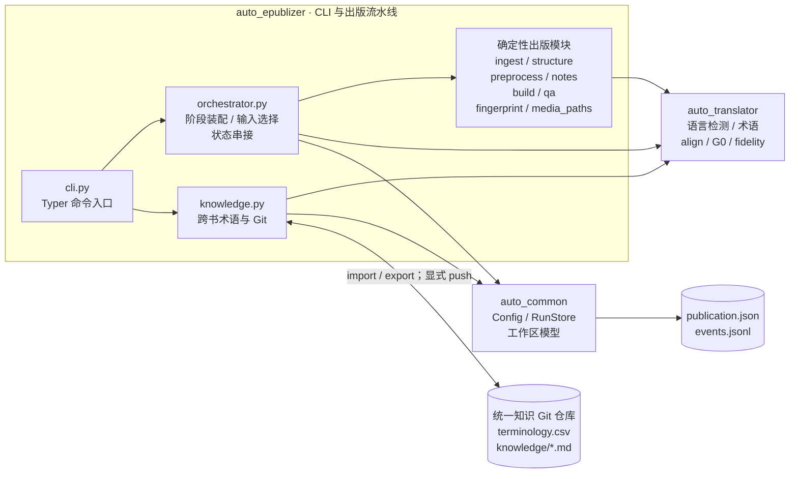
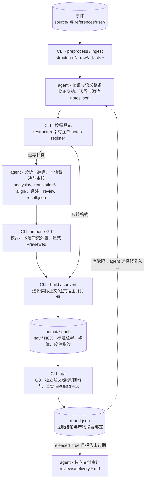

> **中文** | [English](architecture.md)

# auto-epublizer 当前架构

本页描述**当前源码实现**，不是将设计约束或未接线的模块当成已经运行的能力。项目是文件工作区驱动的 Python CLI，不是常驻翻译服务；唯一 LLM 是操作 CLI 的外部 agent。修改包边界、命令、持久化或验收路径时同步更新本页。

## 1. 组件与依赖

图中实线表示主要生产调用或状态持久化关系，不是逐文件完整 import 图；普通内容文件的读写边省略。`doctor`、元数据编辑、工作根目录脚手架等辅助命令未展开。

### 包边界与实现现状

- **`auto_common` 是基础层**：配置、工作区模型、源身份与原子状态读写；不反向导入另外两个包。
- **`auto_translator` 是确定性领域工具包**：没有翻译 worker、LLM provider 或语义 reviewer。允许它依赖 common 的分层约束不等于当前存在实际导入；目前生产连接由 epublizer 同时使用两个包完成，不能把 translator → common 画成已存在的调用边。
- **`auto_epublizer` 是出版应用层**：解析、登记、构建、验收和 CLI。当前不存在独立 `services/` 包；阶段装配、逐单元源/译输入选择、逐注文宿主计划及若干登记逻辑仍在 `orchestrator.py`，不能将“薄 façade”目标理解为这些职责已经全部拆走。
- **纯函数存在不等于生产能力已接通**：`analysis/service.py` 的样式文档助手、genre 档案、`review/convergence.py` 的收敛逻辑不是当前自动分析/自动审校循环；当前没有 `analyze`、自动翻译或自动 G1–G3 执行命令。
- **没有当前 SQLite 术语后端**：`Glossary` 是内存索引，工作区术语权威是 CSV；历史文档中出现的 `glossary.db` 不应画成在用数据库。

## 2. agent 与 CLI 的协作数据流

这是典型执行链，不是 CLI 自动执行的语义流水线。agent 写理解、翻译和审校结果；CLI 只做确定性处理、契约核对与登记。有注书须在翻译前核证、拆离并登记源注。

- `preprocess` 输出事实和可疑信号，不替 agent 决定语义修复。源稿正文修改不总要 `restructure`；单元集合、边界或描述变化时才需重登记。当前 `restructure` 比较单元描述字段，不以正文摘要自动决定状态回退。
- `structured/notes.json` 保存稳定 note/ref 身份、完整源注及原位置证据；正文以 `[^ref-…]` 保持引用位置。`notes register` 核对候选处置、图契约及双向标记，CLI 不代写语义内容。
- `translation/notes.json` 绑定源注摘要并保持 note_id；build 的同一实际输入/宿主计划约束渲染和 QA，不以磁盘上是否存在某个译注文件猜配。未实际使用的译注不冒充产品内容。
- `convert` 使用源稿；`build` 译稿优先、缺失时可逐单元回退源稿。源文回退不证明全文翻译已完成；align 是审查与保真基线，不是成品排版开关。
- `import --reviewed` 是 agent 对审校接受的显式登记，不是运行语义审校。QA 读取 agent 的 review 统计，不自行裁定翻译准确性；修复入口由 agent 依据缺陷选择，不存在自动语义修复循环。

## 3. 权威、派生物与状态

| 数据 | 所有权 / 用途 | 不应误解为 |
|---|---|---|
| `source/`、`references/user/` | 不可变原件；初始化记录源 SHA-256 | 可修订的工作副本 |
| `publication.json` | CLI 经 RunStore 原子登记的元数据、单元及状态、源注摘要 | agent 可手改的待办清单 |
| `structured/*.md`、`structured/raw/`、源 `notes.json` | 源稿、可重建解析证据及 agent 核证的源注图 | 全部都不可变，或全部由 CLI 自动修好 |
| `raw/inserts/<id>.json` | 单个插入内容权威；agent 补描述/LaTeX | `index.jsonl` 汇总快照能代替单文件 |
| `preprocessing/facts.*` / 其他预处理文件 | 前者由 CLI 刷新；plan/global/repairs 等由 agent 维护 | 事实采集已经完成语义理解 |
| `analysis/glossary.csv`、`analysis/glossary_conflicts.jsonl` | 工作区术语权威与未决冲突账本 | SQLite 数据库；只改 CSV 就必然清空冲突 |
| `translation/`、`align/*.jsonl`、译 `notes.json` | agent 语义产物；import 校验和登记，align 可追加确定性勘误注记 | 文件存在便等于状态已登记 |
| `reviews/review-*/result.json`、交付记录 | agent 审校与交付核证；CLI 读取统计或提示记录缺失 | CLI 已自动完成 G1–G3 或阅读器实测 |
| `report.json`、`output/*.epub` | QA 证据与产品，按实际文件摘要关联 | 旧 released=true 永远有效 |
| 知识仓库 `terminology.csv`、`conflicts.jsonl`、`knowledge/*.md` | 跨书术语内容、历史冲突、agent 笔记；Git 持久化 | 自动知识推理或双向同步服务 |

RunStore 使用同目录临时文件、`fsync`、`os.replace` 及锁管理状态；`events.jsonl` 是追加账本。`.progress.json` 是保留路径，不是当前批次断点实现。

模型声明 `pending / split / analyzed / translated / aligned / reviewed / built`。当前主要推进是 init/解析 → split，import → translated / aligned，`--reviewed` → reviewed，build/convert → built；`analyzed` 并不表示存在自动分析命令。`built` 只表示打包完成，不等于 QA 放行或 agent 交付审计完成。

## 4. 外部工具与放行边界

| 边界 | 当前行为 |
|---|---|
| 本地摄入 | TXT/Markdown 本地解析；HTML/DOCX 用 Pandoc；EPUB 读 spine 并借助 Pandoc；Kindle 经 calibre 转临时 EPUB |
| PDF | 自动模式对带 key 的扫描件选择 MinerU，否则 PyMuPDF；本地 OCR 是按空文字页触发的可选 RapidOCR。强制 backend 尊重显式配置；MinerU 失败不会自动退到本地 |
| 可选远端解析 | MinerU 是外部 HTTP 解析服务，key 仅从环境读取；不将其内部实现画成项目内 LLM。Tesseract/ocrmypdf 的能力提示不代表 reader 已自动串接它们 |
| 外部校验 | EPUBCheck 在本地 Java 进程运行，须完整 JAR 与相邻 lib；无 GUI 也可运行。必须实际 `ran=true && returncode=0 && errors=0` |
| Git | knowledge import 可自动本地 commit；push 是显式操作，不自动 pull 或双向同步。跨书笔记的语义仍由 agent 维护 |

放行是多门聚合，不只看 EPUBCheck：G0 硬缺陷、未决术语/源盘点、未修订审校问题、结构、来源覆盖、媒体、align↔正文、成品注文均须满足当前契约。有效源注登记并执行独立注文门后，才移交旧脚注计数/必须有回链判据；合法无引用注文不伪造引用。

缺退出证据的旧放行报告或摘要不匹配的报告会 stale；status/ledger 不把它计作有效放行。指纹是离线出处记录，不是遥测、数字签名或版权授权。标准 noteref/aside 内容与往返链接必须核证，**阅读器是否弹窗只可条件性实测，桌面不是交付前提**。

## 5. 源码定位

| 范围 | 实现入口 |
|---|---|
| 命令与阶段装配 | [cli.py](../src/auto_epublizer/cli.py)、[orchestrator.py](../src/auto_epublizer/orchestrator.py) |
| 工作区 / 状态原子性 | [workspace/models.py](../src/auto_common/workspace/models.py)、[workspace/store.py](../src/auto_common/workspace/store.py) |
| 摄入 / 结构 / 事实 | [ingest/load.py](../src/auto_epublizer/ingest/load.py)、[structure/rebuild.py](../src/auto_epublizer/structure/rebuild.py)、[preprocess/facts.py](../src/auto_epublizer/preprocess/facts.py) |
| 注释图及独立成品门 | [notes.py](../src/auto_epublizer/notes.py)、[qa/notes_audit.py](../src/auto_epublizer/qa/notes_audit.py) |
| 构建 / 指纹 / 资源身份 | [build/](../src/auto_epublizer/build/)、[fingerprint.py](../src/auto_epublizer/fingerprint.py)、[media_paths.py](../src/auto_epublizer/media_paths.py) |
| 校验与报告有效性 | [qa/report.py](../src/auto_epublizer/qa/report.py)、[qa/provenance.py](../src/auto_epublizer/qa/provenance.py)、[qa/epubcheck.py](../src/auto_epublizer/qa/epubcheck.py)、[qa/artifacts.py](../src/auto_epublizer/qa/artifacts.py) |
| 领域工具与跨书知识 | [auto_translator/](../src/auto_translator/)、[knowledge.py](../src/auto_epublizer/knowledge.py) |

分工准则见 [agent-vs-code](agent-vs-code.zh.md)，操作路由见 [SKILL](../skills/auto-epublizer/SKILL.zh.md)，验收契约见 [quality-control](quality-control.zh.md)。
